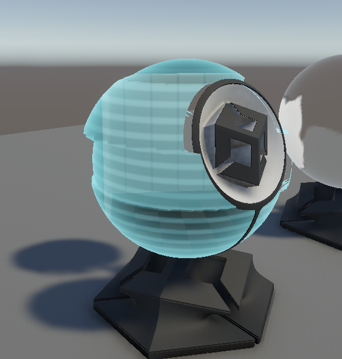
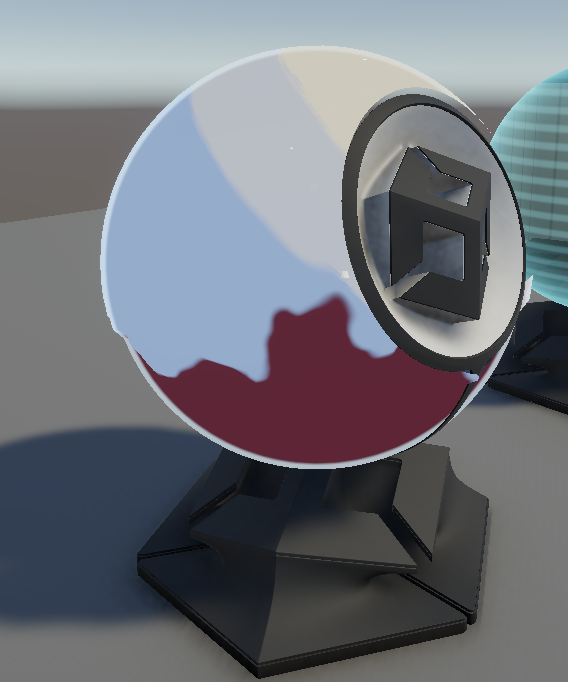
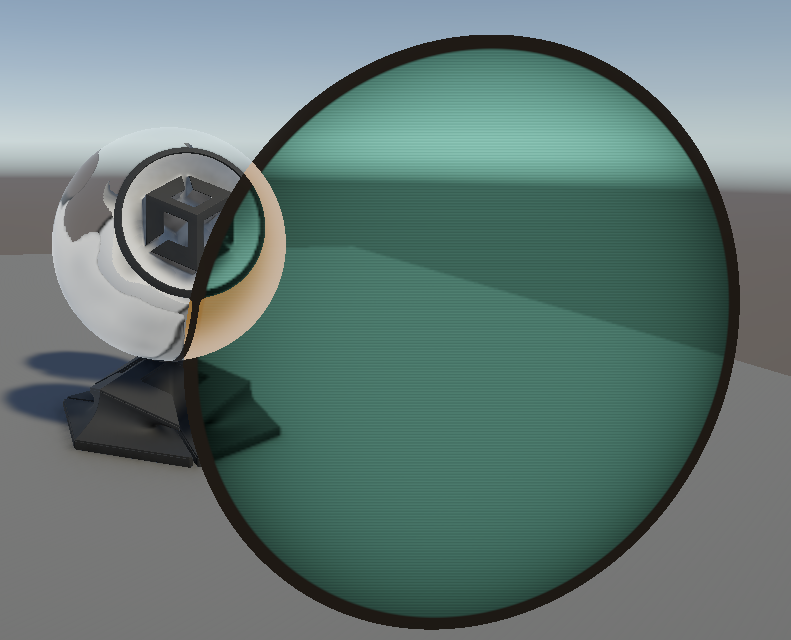

# 나만의 셰이더 제작

shader-gallery의 효과 2~3개를 **합치고 고쳐서** 새로운 효과 3개를 만들었습니다. 모두 HLSL 코드(`.shader`)로 작성한 URP 셰이더입니다.

| # | 셰이더 | 효과 | 합친 갤러리 효과 | 데모 |
| --- | --- | --- | --- | --- |
| 1 | `MyShaders/HoloOrb` | 안에 입체 방이 들어 있는 홀로그램 구슬 | 인테리어 매핑 + 홀로그램 | `Study Shader` 셰이더볼 1 |
| 2 | `MyShaders/WinterToon` | 위쪽에 눈이 쌓이는 만화풍 오브젝트 | 램프 툰 조명 + 젖음과 눈 쌓임 + 프레넬 림 빛 | `Study Shader` 셰이더볼 2 |
| 3 | `MyShaders/CloakedTarget` + `MyShaders/RevealLens` | 투명화된 적이 특수 렌즈로 볼 때만 보임 | 클로킹 투명화 + 가려진 실루엣 + **스텐실(직접 추가)** | `Study Shader` 셰이더볼 3 + 렌즈 Quad |

- 데모 씬: `Assets/00. Scenes/Study Shader.unity`
- 셰이더 폴더: `Assets/02. MyShaders/01_HoloOrb`, `02_WinterToon`, `03_LensReveal`
- 시간에 따라 움직이는 효과(HoloOrb, LensReveal)는 Play 모드 또는 Scene 뷰의 **Always Refresh**를 켜고 확인합니다.

---

## 1. HoloOrb — 홀로그램 기억 구슬

구슬 안을 들여다보면 **작은 방 하나가 입체로** 들어 있고, 구슬 겉면은 홀로그램처럼 빛나고 깜빡입니다.

### 동작 원리

**① 구슬 안의 방 (인테리어 매핑)**
- 카메라 위치를 구슬 기준 좌표로 바꿔서 본다. 그래서 구슬을 돌리거나 옮겨도 방이 같이 따라간다.
- 방은 진짜로 만든 게 아니라 구슬 안에 안 보이는 상자가 있다고 치는 거다.
- 구슬 표면의 픽셀마다 "여기로 들여다보면 방의 어느 벽이 보일까"를 계산해서 그 벽을 칠한다. 바닥이면 체크무늬, 천장이면 등, 벽이면 판자나 창문이다.
- 카메라를 움직이면 보이는 벽도 바뀌어서 진짜 입체 방처럼 보인다.

**② 홀로그램**
- 0.1초마다 구슬을 가로로 나눈 띠 중 몇 개를 골라서 옆으로 밀어 버린다. 그래서 화면이 지직거리듯 툭툭 튄다.
- 시간을 0.1초 단위로 끊어서 쓰기 때문에 부드럽게 출렁이지 않고 멈춰 있다가 갑자기 튄다.
- 그 외에 테두리가 빛나고, 가로줄이 위로 흐르고, 가끔 깜빡인다.

### 갤러리에서 바꾸거나 더한 부분
- **창 여러 개 → 방 하나:** 원본은 평평한 벽을 창 칸으로 나누고 칸마다 방을 넣습니다. 이것을 **구 안에 방 하나**로 바꾸고, 교차 방식도 "창에서 들어가는 방"에서 "카메라 시선이 상자를 빠져나가는 점"으로 바꿨습니다. 시선이 상자를 비껴가는 곳은 안개색(`_VoidColor`)으로 칠해 방이 구 안에 떠 있게 했습니다.
- **방 그림 텍스처 → 코드로 그린 방:** 텍스처 없이 바닥, 벽, 창문, 천장 등을 코드로 그립니다. 원하는 그림을 쓰도록 **큐브맵 모드**(`_UseRoomCube`)도 추가했습니다.
- **방 회전 (`_RoomSpin`):** 시선을 Y축으로 회전시켜서 방이 구슬 안에서 천천히 돕니다.
- **글리치와 방 연동:** 글리치로 밀린 표면 위치로 시선을 다시 계산하므로, 띠가 튈 때 **안쪽 방도 같이 어긋납니다.**

### 프로퍼티
| 프로퍼티 | 설명 |
| --- | --- |
| `_RoomSize`, `_RoomSpin` | 방 상자 크기 / 회전 속도 |
| `_WallColor`, `_FloorColor`, `_FloorTiles`, `_WallPanels` | 벽·바닥 색 / 타일·판자 수 |
| `_WindowColor`, `_LampColor`, `_LampIntensity`, `_LampFalloff`, `_RoomAmbient` | 창밖 빛 / 천장 등 색·밝기·퍼짐 / 기본 밝기 |
| `_VoidColor` | 방 바깥 빈 공간 색 |
| `_UseRoomCube`, `_RoomCube`, `_CubeExposure` | 큐브맵으로 방 그리기 |
| `_HoloColor`, `_HoloTint` | 홀로그램 색 / 방에 입히는 정도 |
| `_RimPower`, `_RimStrength` | 테두리 좁히기 / 밝기 |
| `_LineSpacing`, `_ScanSpeed`, `_ScanStrength` | 스캔라인 간격 / 속도 / 세기 |
| `_GlitchStrength`, `_Flicker` | 글리치 / 깜빡임 세기 |

---

## 2. WinterToon — 눈 쌓인 만화풍 오브젝트

만화처럼 계단식으로 끊긴 음영 위에, 물체의 **위쪽에만 눈이 쌓이고** 윤곽에 차가운 역광이 들어옵니다.

### 동작 원리

**① 툰 음영**
- 빛의 방향과 표면이 향하는 방향(법선)의 내적을 픽셀마다 구한다. 빛을 정면으로 받을수록 1에 가깝다.
- 이 내적 값이 어느 범위에 있는지에 따라 밝기를 몇 단계로 딱딱 끊어서 넣는다. 그래서 음영이 부드럽게 이어지지 않고 만화처럼 계단식으로 나온다.
- 그늘은 검은색 대신 푸른 그늘 색으로 칠한다.

**② 눈 쌓기**
- 월드 기준으로 표면이 위를 보고 있는지(법선의 y)를 보고, 위를 보는 면에 눈을 쌓는다. 그래서 물체를 돌려도 눈은 항상 하늘 쪽에 있다.
- 3D 노이즈를 더해서 눈 경계를 들쑥날쑥하게 바꾼다.

**③ 림**
- 윤곽 쪽만 밝게 해서 차가운 역광처럼 보이게 한다.

### 갤러리에서 바꾸거나 더한 부분
- **눈에도 툰 음영:** 원본의 눈은 일반 조명인데, 눈에도 같은 계단 음영과 눈 전용 그늘 색(`_SnowShadeColor`)을 써서 만화풍 눈으로 만들었습니다.
- **눈 두께 (`_SnowHeight`):** 눈 마스크를 정점 셰이더에서도 계산하고, 눈 덮인 정점을 **법선 방향으로 밀어** 눈이 두껍게 쌓인 것처럼 부풀렸습니다. 그림자 패스도 같은 정점을 써서 그림자 모양도 함께 부풉니다.
- **툰 림 (`_RimHardness`):** 부드러운 림을 `smoothstep`으로 끊어 딱 떨어지는 띠로 만들 수 있게 했습니다.
- **역광 (`_RimBacklight`):** 빛을 덜 받는 쪽(계단 값이 낮은 쪽) 윤곽일수록 림을 강하게 해서 역광처럼 보이게 했습니다.

### 프로퍼티
| 프로퍼티 | 설명 |
| --- | --- |
| `_BaseMap`, `_BaseColor` | 기본 텍스처 / 색 |
| `_ShadeColor`, `_Bands`, `_Softness`, `_ShadeShift` | 그늘 색 / 단계 수 / 경계 부드러움 / 그늘 넓이 |
| `_SnowColor`, `_SnowShadeColor` | 눈 색 / 눈 그늘 색 |
| `_Coverage`, `_SnowSoftness`, `_NoiseScale` | 눈 덮인 정도 / 경계 부드러움 / 경계 노이즈 크기 |
| `_SnowHeight`, `_Glint` | 눈 두께 / 반짝임 세기 |
| `_RimColor`, `_RimPower`, `_RimIntensity`, `_RimHardness`, `_RimBacklight` | 림 색 / 좁히기 / 세기 / 딱딱함 / 역광 정도 |

---

## 3. LensReveal — 렌즈로만 보이는 투명화된 적

적은 투명화되어 있어서 맨눈으로는 **배경이 유리처럼 일렁이는 것**만 보입니다. 특수 렌즈를 통해 보면 **그 적의 주황 실루엣**이 드러납니다. 셰이더 2개(`CloakedTarget` 적용, `RevealLens` 렌즈용)가 **스텐실 버퍼**로 서로 연결되어 동작합니다.

### 동작 원리

**① 투명화**
- 먼저 바닥, 벽 같은 다른 불투명 물체를 다 그리고, 그 화면을 사진처럼 한 장 복사해 둔다.
- 적을 그릴 차례가 오면 적의 몸 자리에 그 사진에서 뒤쪽 배경을 가져와 칠한다. 그래서 몸이 투명해 보인다.
- 배경을 살짝 휘어서 가져오기 때문에 몸이 있는 자리가 유리처럼 일렁여 보인다.

**② 렌즈와 실루엣 (스텐실)**
- 렌즈가 먼저 그려지면서 화면에서 렌즈가 덮고 있는 픽셀에 16이라는 숫자를 적어 둔다.
- 적은 16이 적힌 곳(렌즈 안)에는 실루엣을 그리고, 16이 없는 곳(렌즈 밖)에는 투명화를 그린다.
- 그래서 같은 적이 맨눈으로는 안 보이고 렌즈로 볼 때만 주황색으로 보인다.

### 갤러리에서 바꾸거나 더한 부분
- **스텐실 연결:** 갤러리에 없는 기법입니다. 두 셰이더가 스텐실 번호로 렌즈 안/밖을 나눠 같은 물체를 다르게 그립니다.
- **실루엣이 나오는 조건 변경:** 원본 「가려진 실루엣」은 벽에 가려진 부분(`ZTest Greater`)에 실루엣을 그립니다. 여기서는 그 실루엣 색칠 방식만 가져오고, **렌즈 안이라는 조건**(스텐실)으로 실루엣을 그리게 바꿨습니다.
- **투명화 단순화:** 원본 클로킹의 은신 진행 마스크(높이 훑기, 디졸브 등)는 빼고, `_Cloak` 값 하나로 몸 ↔ 투명을 섞게 했습니다.
- **렌즈 셰이더 새로 작성:** 탐지 스코프 화면(흑백·색·스캔라인·비네트·테두리)을 직접 만들었습니다.

### 프로퍼티
**CloakedTarget**

| 프로퍼티 | 설명 |
| --- | --- |
| `_StencilRef` | 스텐실 번호 (렌즈와 같은 값) |
| `_BaseColor`, `_Cloak` | 몸 색 / 투명화 정도 (0이면 몸이 보임) |
| `_Refraction`, `_NoiseScale`, `_ShimmerSpeed` | 굴절 세기 / 일렁임 무늬 크기 / 속도 |
| `_RimColor`, `_RimPower`, `_RimStrength` | 투명화 테두리 색 / 좁히기 / 세기 |
| `_SilhouetteColor`, `_Opacity`, `_RimWidth`, `_PulseSpeed` | 실루엣 색 / 안쪽 불투명도 / 테두리 폭 / 맥박 속도 |

**RevealLens**

| 프로퍼티 | 설명 |
| --- | --- |
| `_StencilRef` | 스텐실 번호 (적과 같은 값) |
| `_Shape`, `_RingWidth`, `_RingColor` | 모양(원 / 메시 전체) / 테두리 두께·색 |
| `_LensTint`, `_Desaturate`, `_Brightness` | 렌즈 색 / 흑백 정도 / 밝기 |
| `_ScanDensity`, `_ScanStrength`, `_Vignette` | 스캔라인 밀도·세기 / 가장자리 어둡게 |

---

## 공통 사항
- 모든 셰이더는 SRP Batcher 호환을 위해 머티리얼 값을 `CBUFFER_START(UnityPerMaterial)` 안에 두었습니다.
- 효과 본체는 `*Core.hlsl`(또는 `LensRevealCommon.hlsl`)에, 프로퍼티와 패스 설정은 `.shader`에 나눴습니다.
- 한 물체를 여러 번 그리는 셰이더(CloakedTarget)는 URP가 같은 `LightMode` 패스를 하나만 그리기 때문에 패스마다 다른 태그(`UniversalForwardOnly`, `SRPDefaultUnlit`)를 썼습니다.
- 노이즈 텍스처 대신 오브젝트 위치로 계산한 3D 값 노이즈를 써서 UV 이음매에서 끊기지 않습니다.
